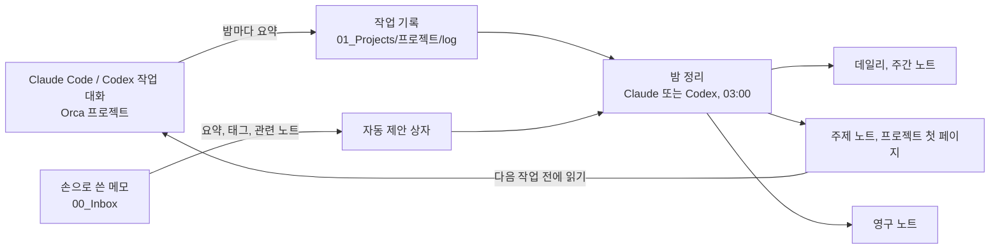

# 제7의 뇌

Orca에서 Claude Code나 Codex로 일한 대화와 손으로 쓴 메모가, 사람이 손대지 않아도 매일 밤 Obsidian 볼트에 정리되는 시스템이다. 아침에는 데일리 노트 하나만 열면 된다.

- **작업이 기록으로 남는다.** 그날 한 작업 대화를 로컬 모델이 요약해 프로젝트와 주제별 작업 기록으로 쌓는다. 무엇을 했고, 어떻게 했고, 다음에 뭘 할지가 들어간다.
- **하루가 한 화면에 정리된다.** 데일리 노트는 결정할 일, 다음 할 일, 오늘 한 일, 관련 노트 순서로 쓰인다. 자세한 내용은 접혀 있다.
- **다음 작업이 맥락을 이어받는다.** Claude Code나 Codex가 작업을 시작하기 전에 그 프로젝트의 첫 페이지를 먼저 읽는다.
- **민감한 것은 밖으로 안 나간다.** 요약과 분류는 PC 안의 로컬 모델(Hermes)이 하고, 비용이 드는 클라우드 모델은 밤에 한 번만 쓴다. `99_Private` 폴더는 클라우드로 보내지 않는다.

## 어떻게 도나



매일 03:00 Windows 작업 스케줄러가 세 단계를 차례로 돌린다.

1. **작업 기록 (Hermes, 로컬, 비용 0).** 그날 Orca 안에서 한 Claude Code와 Codex 대화를 요약한다. 프로젝트는 대화의 작업 폴더로 정확히 정하고, 주제는 그 프로젝트의 주제 노트 목록에서 고른다.
2. **Inbox 정리 (Hermes, 로컬, 비용 0).** `00_Inbox`의 새 메모 끝에 요약, 태그, 관련 노트를 접힌 상자로 붙인다. 메모 본문은 건드리지 않는다.
3. **밤 정리 (Claude Code 또는 Codex).** 데일리 노트, 주제 노트, 프로젝트 첫 페이지를 쓰고, `#정리해줘`를 단 노트를 영구 노트로 정리한다. 월요일에는 지난주를 묶은 주간 노트를 만든다. 끝나면 볼트 전체에서 끊긴 링크와 빈 노트를 찾아 로그에 남긴다.

PC가 03:00에 꺼져 있었으면 다음에 켰을 때 밀린 날부터 처리한다.

## 필요한 것

| 무엇 | 왜 | 비고 |
|---|---|---|
| Windows 10/11 | 작업 스케줄러, PowerShell 5.1 | 기본 설치된 것으로 충분 |
| [Obsidian](https://obsidian.md) | 노트를 보는 곳 | 커뮤니티 플러그인 필요 없음 |
| [Ollama](https://ollama.com) + `hermes3:8b` | 로컬 요약 모델 | GPU 메모리 8GB 정도. 부족하면 `hermes3:3b` |
| Orca | 작업 환경. 프로젝트 구분의 기준 | 기본 위치 `%USERPROFILE%\orca` |
| Claude Code 또는 Codex | 작업, 그리고 밤 정리 | 둘 다 있으면 밤 정리는 Claude Code가 맡는다 (이유는 아래 Codex 절) |

## 설치

### 1. 준비물

```powershell
# Ollama를 설치한 뒤
ollama pull hermes3:8b

# Claude Code 또는 Codex를 설치하고 한 번 로그인해 둔다
claude          # 처음 실행 때 로그인
codex login
```

### 2. 내려받기

```powershell
git clone https://github.com/tirofina/seventh-brain.git
cd seventh-brain
```

### 3. 페르소나 정하기

`persona.md`에 Claude/Codex가 맡을 역할과 말투를 적는다. 설치할 때 메모장으로 자동으로 열리니 그때 써도 된다. 예시는 [examples/persona-연구-파트너.md](examples/persona-연구-파트너.md)에 있다 (생체신호, AI, HCI 연구용). 이 내용은 `~/.claude/CLAUDE.md`와 `~/.codex/AGENTS.md`의 한 구역에 들어간다. 바꾸고 싶으면 `persona.md`를 고치고 설치를 다시 돌리면 그 구역만 바뀐다.

### 4. 설치 실행

```powershell
powershell -NoProfile -ExecutionPolicy Bypass -File .\install.ps1
```

볼트는 기본으로 `%USERPROFILE%\SeventhBrain`에 만들어진다. 다른 곳에 두려면:

```powershell
powershell -NoProfile -ExecutionPolicy Bypass -File .\install.ps1 -VaultPath "D:\Notes\SeventhBrain"
```

설치가 하는 일:

| 단계 | 내용 |
|---|---|
| 0 | Ollama, 모델, Claude Code, Codex, Orca 폴더 확인 (없으면 경고만) |
| 1 | `persona.md`를 메모장으로 연다. 저장하고 닫으면 계속된다 |
| 2 | 볼트 폴더와 기본 노트(홈, 대시보드, 규칙, 템플릿)를 만든다. 이미 있는 파일은 덮지 않는다 |
| 3 | 야간 스크립트와 `config.json`을 `볼트\90_Meta\scripts`에 넣는다 |
| 4 | Claude Code(`~/.claude/CLAUDE.md`)와 Codex(`~/.codex/AGENTS.md`)에 페르소나와 볼트 사용 규칙을 넣는다. 원래 내용은 그대로 두고, 바꾸기 전에 백업한다 |
| 5 | Orca의 각 프로젝트(`orca\workspaces\<프로젝트>`)에 CLAUDE.md 구역을 넣고, 볼트에 그 프로젝트의 첫 페이지를 만든다 |
| 6 | Claude Code 권한에 볼트 읽기, 결정 기록 쓰기, `99_Private` 차단을 더한다 (`~/.claude/settings.json`, 백업 후) |
| 7 | 매일 03:00 작업(`Hermes-Inbox-Nightly`)을 등록한다. 관리자 권한은 필요 없다 |

여러 번 돌려도 된다. 새 Orca 프로젝트를 만든 뒤 다시 돌리면 그 프로젝트도 연결된다.

| 옵션 | 뜻 |
|---|---|
| `-VaultPath` | 볼트 위치 |
| `-OrcaRoot` | Orca 폴더 (기본 `%USERPROFILE%\orca`) |
| `-NightEngine claude` 또는 `codex` | 밤 정리를 누가 할지. 비우면 Claude Code가 있으면 Claude |
| `-SkipPersonaEdit` | 메모장을 열지 않는다 |
| `-SkipClaudeConfig` | CLAUDE.md, AGENTS.md, settings.json을 건드리지 않는다 |
| `-SkipWorkspaceFiles` | Orca 프로젝트 폴더에 CLAUDE.md를 만들지 않는다 |
| `-SkipSchedule` | 작업 스케줄러에 등록하지 않는다 |

### 5. Obsidian 열기

1. Obsidian에서 "폴더를 볼트로 열기"로 볼트 폴더를 연다.
2. 설정 > 코어 플러그인에서 "데일리 노트"와 "템플릿"을 켠다.
3. 홈 노트 `_볼트-가이드`와 `_대시보드`를 둘러본다.

### 6. 한 번 돌려 보기

밤까지 기다리지 않고 지금 돌려 볼 수 있다.

```powershell
Start-ScheduledTask -TaskName 'Hermes-Inbox-Nightly'
```

결과는 `볼트\90_Meta\scripts\hermes-inbox.log` 끝에 남는다. `[gardener] Done. is_error=False`와 `links ok`가 보이면 정상이다. 첫 실행은 "어제"를 마무리하므로, 오늘 한 작업은 다음 날 03:00에 데일리로 정리된다.

## 매일 쓰는 법

- **아무것도 안 해도 된다.** 평소처럼 Orca에서 Claude Code나 Codex로 일한다.
- 아침에 `03_Daily`의 어제 데일리 노트를 연다. 결정할 일과 다음 할 일 중 끝낸 것은 체크한다. 다음 날 밤에 빠진다.
- 떠오른 것은 `00_Inbox`에 메모로 던져 둔다. 밤에 요약과 태그가 붙는다.
- 꼭 개념 노트로 엮고 싶은 메모에는 `#정리해줘`를 단다.
- 남에게 보이면 안 되는 기록은 `99_Private`에 쓴다.
- 작업 중 중요한 결정이나 발견은 Claude/Codex가 그날 데일리의 `## 메모`에 접힌 상자로 남긴다 (설치 때 넣은 지침).

## 예시

데일리 노트 (Obsidian에서는 오늘 한 일과 메모가 접힌 상자로 보인다). 전체는 [examples/데일리-노트-예시.md](examples/데일리-노트-예시.md).

```markdown
# 11월 16일 월요일

## 결정할 일
- [ ] 비밀번호 강도 기준을 정하기: 8자 이상만 볼지, 문자 종류까지 볼지 정해야 표시를 만들 수 있다

## 다음 할 일
- [ ] 회원가입 폼에 비밀번호 강도 표시 붙이기 [[비밀번호 입력칸 개선]]

## 오늘 한 일
> [!done]- 로그인 화면: 비밀번호 보기 버튼을 넣었다
> - 어떻게: 입력칸 옆에 눈 모양 토글을 두고, 누르면 입력 형식이 바뀌게 했다
> - 결과: 테스트 2개를 더해 모두 통과했다
> - 근거: [[비밀번호 입력칸 개선하기]]

## 관련 노트
- [[비밀번호 입력칸 개선]]

## 메모

> [!note]- 14:20 비밀번호 표시 버튼은 접근성 속성을 함께 단다
> 결정: 토글 버튼에 aria-pressed를 단다. 화면 읽기 프로그램이 상태를 읽을 수 있게 하기 위함이다.
```

작업 기록 (밤마다 대화에서 자동으로 만들어진다). 전체는 [examples/작업-기록-예시.md](examples/작업-기록-예시.md).

```markdown
> [!summary] 로그인 화면의 비밀번호 입력칸에 보기 버튼을 넣었다

**무엇을**
비밀번호를 확인하기 어렵다는 의견이 있어 입력한 비밀번호를 볼 수 있게 했다.

**어떻게**
- 입력칸 옆에 눈 모양 토글 버튼을 넣었다.
- 테스트 2개를 더했다.

**다음에 할 일**
- [ ] 비밀번호 강도 표시 붙이기
```

## 볼트 구조

```
00_Inbox/          새 메모. 밤에 요약, 태그, 관련 노트가 붙는다
01_Projects/       Orca 프로젝트별
  <프로젝트>/
    _index.md        프로젝트 첫 페이지 (작업 세션이 먼저 읽는다)
    <주제>.md        주제 노트: 지금 상태, 흐름, 정한 것, 남은 질문
    decisions/       결정 기록 (이름에 날짜 없음)
    log/<주제>/      작업 기록 (밤마다 자동)
02_Notes/          영구 노트 (프로젝트를 넘어서는 개념)
03_Daily/          데일리 YYYY-MM-DD.md, 주간 YYYY-Www.md
04_References/     외부 자료
90_Meta/           규칙, 스크립트, 템플릿
99_Private/        비공개. 클라우드로 보내지 않는다
```

- 날짜가 이름에 들어가는 노트는 데일리와 주간 노트뿐이다.
- 작업 기록 이름은 한 번 정해지면 바뀌지 않아 링크가 끊기지 않는다.
- 볼트의 프로젝트 폴더 이름은 바꿔도 된다. 첫 페이지 `_index.md`의 tags에 Orca 프로젝트 이름을 남겨 두면 기록이 그 폴더를 찾아간다.
- 주제를 나누는 기준은 주제 노트의 `description` 한 줄이다. 주제 범위를 바꾸려면 그 줄을 고친다.

## 설정 바꾸기

`볼트\90_Meta\scripts\config.json`:

| 키 | 뜻 | 기본 |
|---|---|---|
| `vaultPath` | 볼트 위치 | 설치 때 정한 값 |
| `orcaRoot` | Orca 폴더 | `%USERPROFILE%\orca` |
| `hermesModel` | 로컬 요약 모델 | `hermes3:8b` |
| `nightEngine` | 밤 정리 엔진 `claude` / `codex` | 설치 때 정한 값 |
| `claudeModel`, `claudeFallbackModel` | Claude 밤 정리 모델 | `claude-opus-5-5`, `claude-sonnet-5-5` |
| `codexModel` | Codex 밤 정리 모델 (비우면 Codex 기본) | 빈 값 |

밤 정리가 무엇을 어떻게 쓰는지는 `90_Meta\scripts\gardener-prompt.md`에 있다. Obsidian에서 열어 고치면 다음 밤부터 바뀐다.

## Codex를 쓸 때

- **작업 기록:** Orca 안에서 한 Codex 대화(`~/.codex/sessions`)도 Claude Code 대화와 똑같이 작업 기록이 된다.
- **지침:** 설치가 `~/.codex/AGENTS.md`에 페르소나와 볼트 규칙을 넣는다. Codex는 워크트리 바깥 폴더의 AGENTS.md를 읽지 않으므로 "작업 전에 프로젝트 첫 페이지를 읽는다"는 규칙도 전역 지침에 들어 있다.
- **개발 세션에서 결정 기록 쓰기:** Codex는 기본으로 작업 폴더 밖에 쓰지 못한다. 볼트에도 쓰게 하려면 `codex --add-dir "<볼트 경로>"`로 띄우거나 `~/.codex/config.toml`에 다음을 넣는다.
  ```toml
  [sandbox_workspace_write]
  writable_roots = ["C:\\Users\\<이름>\\SeventhBrain"]
  ```
- **밤 정리를 Codex로 할 때 (`nightEngine: codex`):** `codex exec`를 볼트를 작업 폴더로 해서 돌린다(`-s workspace-write --ephemeral`). 다만 Codex에는 Claude Code처럼 폴더별로 읽기를 막는 규칙이 없다. 그래서 `99_Private`를 읽지 말라는 것은 지시문으로만 막힌다. 민감한 기록이 많다면 밤 정리는 Claude Code로 하거나, 민감한 기록을 볼트 밖에 둔다.
- 실행당 비용 상한 옵션도 Codex에는 없어서 시간 상한(20분)으로만 막는다.

## 비용과 개인정보

- Hermes 단계는 PC 안에서만 돌아 비용이 없고, 데이터가 밖으로 나가지 않는다.
- 밤 정리는 `99_Private`를 뺀 볼트 내용을 Claude(또는 Codex)로 보낸다.
  - 비용: Claude Opus 기준 1회 약 $0.3-0.8 (실측). 실행당 상한은 $1이다.
  - 구독으로 로그인했다면 과금 대신 사용량 한도에서 빠진다.
- Claude 밤 정리의 안전장치 (`gardener-settings.json`):
  - 셸과 웹을 쓰지 못한다.
  - `99_Private`를 읽지 못한다.
  - 자기 지시문(`90_Meta`)과 Obsidian 설정을 고치지 못한다.
  - 자기 실행 기록을 남기지 않는다.

## 알려진 한계

- 작업 기록은 8B 로컬 모델이 써서 가끔 틀린다. 예를 들어 앞으로 할 일을 이미 한 일처럼 적는 경우가 있다. 밤 정리가 다른 기록과 엇갈리면 데일리에 "확인이 필요하다"고 적지만, 원래 대화가 기준이다.
- PC가 켜져 있고 로그인돼 있어야 03:00에 돈다. 놓친 날은 다음에 켤 때 처리된다.
- Windows 전용이다. macOS/Linux에서는 PowerShell 7과 launchd/cron으로 옮겨야 한다.
- 작업 기록은 Orca 폴더 아래에서 한 대화만 모은다.

## 문제 해결

| 증상 | 확인할 것 |
|---|---|
| 아침에 데일리가 없다 | `hermes-inbox.log` 끝. 그날 작업이 없었으면 데일리를 만들지 않는다 |
| `[capture]` 줄에 오류 | Ollama가 켜져 있는지 (`ollama list`) |
| `[gardener] ERROR: claude CLI not found` | Claude Code 설치, 또는 `config.json`의 `nightEngine`을 `codex`로 |
| Codex 밤 정리가 `401 Unauthorized` | `codex login` |
| `WARN unresolved links` | 끊긴 링크가 있다. 보통 다음 밤에 고쳐진다 |
| 한글이 깨진 채 스크립트가 실패 | `.ps1`을 고쳤다면 UTF-8 with BOM으로 다시 저장 |

## 끄기, 지우기

```powershell
Disable-ScheduledTask -TaskName 'Hermes-Inbox-Nightly'                # 잠시 끄기
Enable-ScheduledTask  -TaskName 'Hermes-Inbox-Nightly'                # 다시 켜기
Unregister-ScheduledTask -TaskName 'Hermes-Inbox-Nightly' -Confirm:$false   # 완전히 지우기
```

지침을 빼려면 `~/.claude/CLAUDE.md`와 `~/.codex/AGENTS.md`에서 `<!-- seventh-brain:start`부터 `<!-- seventh-brain:end -->`까지를 지운다. 설치가 만든 백업(`*.bak-날짜`)도 같은 폴더에 있다.

## 라이선스

MIT. [LICENSE](LICENSE) 참고.
