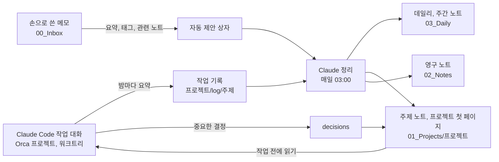

# 볼트 가이드

> [!summary] 작업 대화와 메모가 매일 밤 저절로 정리되는 볼트다. 아침에는 데일리 노트 하나만 보면 된다.

## 매일 밤 3시에 일어나는 일
1. 그날 Claude Code로 작업한 대화를 로컬 Hermes가 요약해, Orca 프로젝트와 주제별 작업 기록으로 남긴다 (`01_Projects/<프로젝트>/log/<주제>/`).
2. `00_Inbox/`에 새로 들어온 메모 끝에 요약, 태그, 관련 노트를 담은 접힌 상자를 붙인다.
3. Claude가 데일리 노트, 주제 노트, 프로젝트 첫 페이지를 새로 쓰고, `#정리해줘`가 달린 노트를 영구 노트로 정리한다. 월요일에는 지난주를 묶은 주간 노트도 만든다.

## 사람이 하는 일
- 꼭 할 일은 없다. 아침에 `03_Daily/`의 데일리 노트나 [[_대시보드]]를 본다.
- 데일리의 결정할 일과 다음 할 일 중 끝낸 것은 체크한다. 다음 날 밤에 빠진다.
- 꼭 엮어 두고 싶은 노트에만 `#정리해줘`를 단다.
- 남에게 보이면 안 되는 기록은 `99_Private/`에 쓴다. 이 폴더는 Claude에게 보내지 않는다.

## 흐름



## 찾아가기
- 어떤 일을 어느 도구에 맡기나 -> [[AI-라우팅-치트시트]]
- 지금 상태 한눈에 -> [[_대시보드]]

## 폴더

```
00_Inbox/          새 메모. 밤에 요약, 태그, 관련 노트가 붙는다
01_Projects/       Orca 프로젝트별 폴더 (첫 페이지, 주제 노트, decisions/, log/)
02_Notes/          영구 노트 (프로젝트를 넘어서는 개념)
03_Daily/          데일리, 주간 노트
04_References/     외부 자료
90_Meta/           운영 (규칙, 스크립트, 템플릿)
99_Private/        비공개. Claude에게 보내지 않는다
_attachments/      첨부
```

`00_Inbox`, `01_Projects`, `90_Meta`, `99_Private`는 스크립트가 참조하므로 이름을 바꾸지 않는다.
